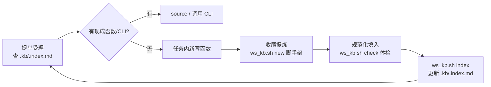

## 产品概述

在 `/data/Agent/xufa/workspace` 下建立代码知识库 `.kb/`（根目录独立隐藏区）：存储不同项目售后分析中重复出现的需求所对应的分析代码。代码按规范编写（R 用 Roxygen Skeleton、Python 用 Google-style docstring）、模块化、参数尽量开放、可独立的分析尽量产出 CLI 版本（R 用 optparse、Python 用 argparse），为后续封装为 skill/agent 工具或专业分析 package 打基础。

## 核心功能

- **规范化函数库**：`.kb/R/<主题>/`、`.kb/python/<主题>/` 按分析主题组织（annotation、visualization、qc 等，与产品无关、跨项目复用）；一函数一文件，详述参数说明与示例
- **CLI 脚本**：`.kb/cli/R/`（optparse）与 `.kb/cli/python/`（argparse），独立可调用，参数命名统一约定，可直接封装为 skill/agent 工具
- **自动索引**：`.kb/.index.md` 由 ws_kb.sh 自动生成（名称 | 主题 | 一句话 | 参数签名 | CLI 路径），Agent 与人都能 grep 快速回溯
- **语法体检**：R parse / Python py_compile 逐文件检查，防止坏代码入库
- **脚手架**：ws_kb.sh new 按模板生成新函数/CLI 骨架，保证入库即合规
- **持续积累闭环**：提单受理时 Agent 先查 `.kb/.index.md` 复用现成函数；收尾时把任务中可泛化的函数规范化提炼入 `.kb/`
- **定位说明**：`.kb/` 是代码唯一事实源；ima 等外部知识库只做文档型只读镜像（后续可选），严禁双写

## 技术栈

- Bash（`.ws/bin/ws_kb.sh`，与现有 ws_* 脚本同体系）+ Python 3.8 纯标准库（转换/索引逻辑零第三方依赖）
- R 4.4.2 + roxygen2（已装）；R CLI 用 optparse（用户指定；执行时先验证可用，缺失则报告用户并暂缓 R CLI 种子）
- 架构图不需要；本次不引入任何新框架

## 目录结构

```
/data/Agent/xufa/workspace/
├── .kb/                              # [NEW] 代码知识库（隐藏，业务资产）
│   ├── README.md                     # [NEW] 编写规范（唯一手工维护文档）
│   ├── .index.md                     # [NEW] 自动生成索引（ws_kb.sh index，勿手改）
│   ├── R/
│   │   ├── annotation/               #   注释类函数（peak/gene annotation 等）
│   │   └── visualization/            #   可视化函数
│   ├── python/
│   │   └── qc/                       #   质控/统计类模块
│   └── cli/
│       ├── R/                        #   kb_<动作>.R（optparse）
│       └── python/                   #   kb_<动作>.py（argparse）
├── .ws/
│   ├── bin/ws_kb.sh                  # [NEW] index / check / new 三个子命令
│   └── templates/
│       ├── kb-function.R.tmpl        # [NEW] R 函数 Roxygen 骨架
│       ├── kb-function.py.tmpl       # [NEW] Python 模块 docstring 骨架
│       └── kb-cli.py.tmpl            # [NEW] argparse CLI 骨架
├── README.md                         # [MODIFY] 目录树加 .kb/、检索维护命令块加 ws_kb.sh
└── .codebuddy/rules/workspace-convention.md   # [MODIFY] 受理先查库、收尾提炼入库
```

## 编写规范（写入 .kb/README.md）

- **R 函数**：一函数一文件，文件名=函数名；Roxygen 骨架含 `@title @description @param（每个参数，含类型与默认值含义） @return @export @examples`（examples 用 `\dontrun{}` 包裹真实数据依赖的调用，纯计算示例可直接跑）
- **Python**：Google-style docstring（Args/Returns/Raises/Example），类型注解写入函数签名
- **CLI 约定**：参数长名统一 snake_case；`--input/--output` 必选语义固定；`--help` 完整可读；CLI 只做参数解析+调用库函数，业务逻辑仍在函数文件中（薄壳原则，为封装 skill 铺路）
- **主题新增**：Agent 提炼入库时按语义归入现有主题，无合适主题才新建子目录

## ws_kb.sh 子命令设计

- `index`：扫描 `.kb/R/**/*.R` 提取 Roxygen `@title`/函数签名，`.kb/python/**/*.py` 提取 docstring 首行与 `def` 签名，`.kb/cli/` 提取 CLI 描述；按语言/主题分组生成 `.kb/.index.md` 表格
- `check`：`Rscript -e 'parse(file=...)'` 逐文件 + `python3 -m py_compile`，输出 OK/FAIL 清单（坏代码不得入库）
- `new -l R|python -t <主题> -n <名称> [-c]`：从模板生成脚手架（`-c` 生成 CLI 版），自动提示随后执行 index

## 数据流



## 实施说明

- 索引解析用正则提取（Roxygen 块以 `#'` 开头，docstring 三引号首行），与现有脚本零依赖风格一致
- 种子示例：R 侧在 annotation 主题放一个贴合演示任务的小函数（如 `promoter_ratio()` 计算 .meta 注释表的启动子占比，Roxygen 完整）；Python 侧放 `cli/python/kb_tsv_stats.py`（tsv 列摘要统计，argparse + docstring），两者立刻有真实用途且可验证
- optparse 验证放在第一步：`Rscript -e 'requireNamespace("optparse")'` 不可用则报告用户，R CLI 种子暂缓、函数库不受影响
- README/规则/长期记忆三处同步；任务打包链路不涉及 .kb/（kb 代码不进客户包）