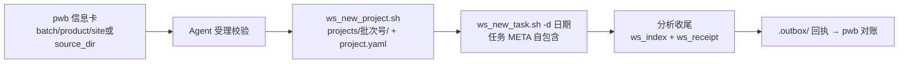

## 需求描述

将 `projects/` 目录命名规则从「产品/年/项目/任务」四级改为「批次号/任务」两级，直接对接 personal-workbench 工作台提单。

## 产品概述

工作空间的项目目录改造：`projects/<批次号>/<YYYYMMDD>_<slug>/`。批次号是用户从工作台带来的任意编号（不再承担产品/年份/合同语义）；原项目层的生产目录映射信息收进新增的 `project.yaml`；任务 META 补 `product` 字段保持自包含；生产目录定位兼容「site 推导」与「全路径直给」两种方式；建任务支持 `-d` 自选日期前缀。

## 核心功能

- **两层项目结构**：`projects/<批次号>/` 下直接放 `<YYYYMMDD>_<slug>/` 任务目录
- **project.yaml**：批次号目录根部的项目级元数据（product/year/site/source_dir/contract/title），建任务时自动带入任务 META
- **生产目录双模定位**：信息卡给 site 则按 `/data/Report/<产品>_project_<年>/` 推导（含当年/近两年/glob 兜底），给完整路径则直接使用
- **日期自选**：`ws_new_task.sh -d <YYYYMMDD>` 覆盖任务名日期前缀，默认当天
- **存量处置**：删除现有 3 个演示任务与旧回执，按新结构重建示例（含 project.yaml、_source 软链、演示任务、受理回执）
- **全链路同步**：扫描、索引、打包、回执、体检、备份脚本与 README/规则/三张架构图全部适配新结构

## 技术方案

沿用现有 Bash + Python 3.8 脚本体系（`.ws/bin/`），无数据库，META.yaml 仍是唯一事实来源。

### 关键改造点（已只读核对）

| 文件 | 改造内容 |
| --- | --- |
| `.ws/bin/_lib.sh` | `resolve_source` 兼容：无 year 时依次试当年/近两年，再 glob `/data/Report/<product>_*/<site>` 兜底 |
| `.ws/bin/ws_new_project.sh` | 参数改为 `-b <批次号> -p <产品> [-y 年] [-s site \ | -src 全路径] [-t 标题]`；项目目录 = `projects/<批次号>`；新增生成 `project.yaml`；`_source` 软链挂在批次号根部 |
| `.ws/bin/ws_new_task.sh` | 加 `-d <YYYYMMDD>` 日期覆盖；从 `project.yaml` 读 product/year/contract 写入任务 META（META 自包含，不再从路径推导） |
| `.ws/templates/META.yaml.tmpl` | 新增 `product` 占位字段 |
| `.ws/bin/ws_meta.py` | `scan()` 改两级结构：`project_rel = projects/<批次号>`；product/year 从任务 META 读取，不再切路径 |
| `.ws/bin/ws_pack.sh` | transform 正则由剥三层改为剥两层：`s | ^projects/[^/]*/[^/]*/\ | \ | ` |
| `.ws/bin/ws_receipt.sh` | productName 改从任务 META 读取 |
| `.ws/bin/ws_check.sh` | 项目发现改两级遍历；rel 拼路径、未纳入项目检查（[3] 段）相应调整 |
| `.ws/bin/ws_index.py` | 分组渲染适配（分组名 = 批次号） |
| `.ws/bin/ws_backup.sh` | 备份清单加入 `project.yaml` |

### 设计要点

- `project.yaml` 使项目层信息机器可读，任务 META 拷贝 product/year 后自包含——回执、索引、备份都只依赖任务 META，与 save2ob「磁盘即事实」原则一致
- 批次号语义放开后 `derive_contract` 仅作兜底：contract 优先取信息卡/project.yaml，缺失时才从编号推导
- scratch/ 结构与「禁止删除 projects/ 内容」规则不变

### 数据流

## Agent Extensions

### Skill

- **dynamic-archify**
- Purpose: 重渲染三张架构图（tree/structure/lifecycle），反映两层目录结构与 project.yaml
- Expected outcome: 三张 HTML 通过布局校验并生成到 `.ws/docs/`，无旧结构残留