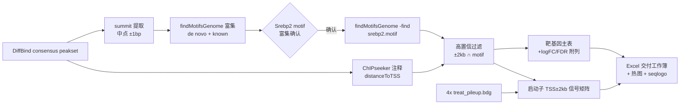

## Product Overview

CUT&Tag 数据分析：鉴定转录因子 Srebf2（SREBP2）的高置信靶基因清单，并定量各靶基因启动子区在 WT/CKO 两组各 2 个样本中的结合强度。方法对齐用户既往流程（参考 /data/Report/atac_project_2026/92601296901_mouse/Analysis/20260729 的 Analysis.R + bash.sh）。

## Core Features

- **consensus peakset motif 富集（新增）**：DiffBind consensus peakset 的 motif 富集此前未做过（生产目录 Motif/ 是按样本的），需先在 consensus peak 上跑 findMotifsGenome.pl（de novo + known），用 OXM getHomerMotifs/MotifResultPlot 排序确认 Srebp2 motif 的富集显著性
- **Srebp2 motif -find 检索**：富集确认后，用 srebp2.motif 在 consensus peak 上做结合位点检索，标记含 motif 的 peak
- 高置信靶基因定义（用户确认）：peak 的 distanceToTSS ∈ ±2kb 且 peak 含 Srebp2 motif；DiffBind 的 logFC/FDR 作为附列并入
- 启动子（TSS ±2kb）结合强度定量：基因 × 样本信号矩阵 + WT vs CKO 热图
- 交付：Excel 多 sheet 工作簿（高置信靶基因主表、启动子强度矩阵、全 consensus peak 注释附表、方法说明）+ 热图 + Srebp2 motif seqlogo QC 图

## Tech Stack

- Motif 富集与检索：沿用用户惯用流程 `findMotifsGenome.pl <bed> mm10 <outdir> -len 8,10,12,14 -S 10 -gc -p 6`（富集）与 `-find <srebp2.motif>`（检索），HOMER 路径 /data/pipeline/scRNA/miniconda/envs/chipseq/bin（mm10 已预解析）
- **bed 构造（用户确认）**：consensus peakset 取 summit——peak 中点 ±1bp（参考流程同款：summit_start=(end-start)/2+start，summit_end=summit_start+1），bed 六列 chr/summit_start/summit_end/Peak/strand/score
- Motif 文件：/data/softwares/anaconda3/share/homer/data/knownTFs/motifs/srebp2.motif（consensus CGGTCACSCCAC）
- R 整合：OXM 包（readFile/mkdir/saveplot/getHomerMotifs/MotifResultPlot/seqlogo_cus，私有库 /data/InHousePackages/OXM/library，经 R_PROFILE_USER 或项目 .Rprofile 激活）+ data.table/GenomicRanges/ggplot2/pheatmap
- 注释复用：生产目录 CKOvsWT_peak_ChIPseeker_annotation.txt（consensus/DB peak 注释，含 geneId/SYMBOL/distanceToTSS）；peak-gene join 按 chr_start_end 对齐（参考流程同款）
- 交付表格：[skill:xlsx] 生成多 sheet Excel 工作簿

## Implementation Approach

1. **输入准备**：任务根目录 `ln -s` 软链 input.*（DiffBind_All.txt、DiffBind 注释表、4 个 treat_pileup.bdg、srebp2.motif），禁 cp；核对 DiffBind_All.txt 与 ChIPseeker 注释表的 peak 坐标/ID 对应关系（1-based/0-based）
2. **Summit bed + Motif 富集**（scripts/run_motif.sh + R）：从 DiffBind consensus peakset 算 summit（中点 ±1bp）生成 consensus.summit.bed，跑 `findMotifsGenome.pl -len 8,10,12,14 -S 10 -gc -p 6`；R/OXM 读结果排序，确认 Srebp2 motif 在 consensus peak 中富集（seqlogo QC 图顺带产出）
3. **Motif 检索**：`findMotifsGenome.pl consensus.summit.bed mm10 <outdir> -find srebp2.motif` 得含 motif peak 列表（MotifTarget，单次）
4. **靶基因整合**（scripts/01_target_genes.R）：MotifTarget peak 按 chr_start_end join 注释表（summit bed 的 Peak 列回溯到 peak 区间坐标）→ 按 distanceToTSS ±2kb ∩ motif 过滤高置信主表，附每样本信号与 DiffBind logFC/FDR；全 peak 注释附表备查
5. **启动子强度**（scripts/02_promoter_signal.R）：注释表推导 TSS（geneStart/geneStrand），构建 TSS ±2kb 窗口，data.table 按染色体分块读 4 个 bdg 算窗口平均信号 → 基因×样本矩阵 → pheatmap 热图（WT/CKO 注释条）
6. **交付**（scripts/03_make_excel.R 或 [skill:xlsx]）：多 sheet Excel + 图；产物 ≤200MB

## Architecture Design

## Implementation Notes

- 动手前先查 `.kb/.index.md` 是否有可复用的 bed/bdg/热图函数，避免重复造轮子
- DiffBind_All.txt 列名先 `head -1` 核对（每样本 counts 与 logFC/FDR 列名可能带样本前缀）
- 注释表 SYMBOL 为 NA 的行保留 geneId，主表 SYMBOL 优先
- HOMER 调用统一用 chipseq 环境绝对路径；R 脚本头部注释激活方式
- motif 富集跑在 consensus summit bed 上（-p 6 并行，几分钟内完成）
- .meta.yaml 收尾须补 methods/scripts/output 并置 done；report.md 按 `.ws/templates/report.md.tmpl` 用 ws_report.sh 渲染；最后 ws_index.sh + ws_receipt.sh done 回执
- 产出仅落 results/；输入软链与元数据不进交付包（ws_pack.sh 自动排除）