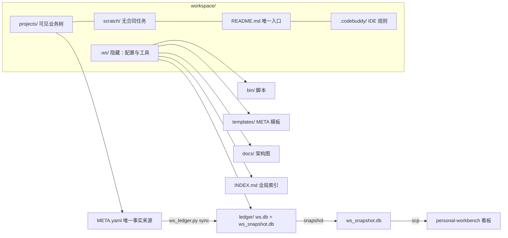

## 产品概述

对 `/data/Agent/xufa/workspace` 做一次「根目录收敛 + 概念瘦身」改造：让工作空间根目录只剩业务内容与一个隐藏的配置/工具区，减少需要记忆的概念数量，同时不破坏现有自动化链路（新建任务、索引、台账、打包、交付、体检、架构图）。

## 核心特性

1. **根目录收敛**：除 `projects/`、`scratch/`、`README.md`、`.codebuddy/` 外，其余全部进入隐藏目录 `.ws/`，层级为 `.ws/bin`、 `.ws/templates`、 `.ws/docs`、 `.ws/ledger`、 `.ws/INDEX.md`
2. **删除空壳目录**：移除至今零内容、无任何脚本引用的 `assets/` 与 `_archive/`
3. **保持 scratch 语义不变**：`scratch/<YYYYMM>/<日期_slug>/` 仍与 `projects/` 同级，作为「无合同归属的业务内容」
4. **台账维持现方案**：`.ws/ledger/ws.db` 为主库，快照名继续叫 `ws_snapshot.db`；列名保持与 personal-workbench 对齐（`contractNo`/`productName`/`speciesName`/`sampleBatch`/`analysisStatus`/`status` 整数镜像/`meta` 表），`schema_version=3`
5. **路径一致性改造**：脚本常量、命令示例、规则文档、架构图全部同步到新路径，杜绝「文档写旧路径」导致的失效
6. **架构图重画**：把树图左栏散落的多个管理节点折叠为一个 `.ws/` 容器，直观表达「隐藏配置区 vs 可见业务树」

## 技术栈

- 现有：Bash（`_lib.sh` + `ws_*.sh`）+ Python 3.8（`ws_index.py` / `ws_ledger.py` / `ws_meta.py`）+ SQLite 3.40（WAL）
- 架构图：`dynamic-archify` skill 的 `renderers/architecture/render-architecture.mjs`（Node 20，输出单文件 HTML）

## 实施策略

**一次性物理搬迁 + 常量改一处 + 文档/图同步**，不是重构：不引入新抽象、不加配置文件，只改路径常量与引用。

关键依据（已只读核实）：

- `bin/_lib.sh:4` 的 `WS_ROOT="$(cd "$(dirname "${BASH_SOURCE[0]}")/.." && pwd)"` —— `bin/` 挪到 `.ws/bin/` 后 `WS_ROOT` 仍正确指向工作空间根，**无需改 WS_ROOT 推导**；`ws_ledger.py` 的 `default_root = dirname(dirname(__file__))` 同理
- `bin/_lib.sh:7` `TEMPLATE_DIR="$WS_ROOT/templates"` 是**唯一**硬编码模板路径，必须改为 `.ws/templates`
- `ws_ledger.py` 顶部 `DB_RELDIR = '.ledger'` 唯一控制主库位置，`db_path_of()` 依赖它；`SNAPSHOT_NAME` 保持不变
- `ws_index.py:105` 是全仓**唯一**写全局 INDEX.md 的位置（第 46 行是项目级/分组级，保持原处）
- `assets/`、`_archive/` 各自仅有 README.md，`grep` 全脚本零引用，删除无副作用

## 执行要点（防回归）

- 搬迁用 `mkdir -p .ws && mv`，**不用 `cp`+删**，避免半途冗余副本；先建 `.ws/` 再逐项 `mv`
- 台账：`mv .ledger .ws/ledger` 后不要 rebuild —— `ws.db` 是绝对路径无关的派生镜像，`rebuild` 只会丢 `events` 流水；跑 `sync` 验证即可
- `__pycache__` 随 `bin/` 一起搬家，迁入后删除，避免脏文件带入新位置
- 渲染前有布局校验（节点间距 ≥24px、标签不可重叠/过宽），失败时先挪坐标或去掉重叠标签再重渲
- 文档改全：`README.md`（19 处）与 `.codebuddy/rules/workspace-convention.md`（14 处）中的 `bash bin/ws_*.sh`、`python3 bin/ws_*.py`、`templates/`、`docs/*.html`、`.ledger` 全部替换
- 验收必须真跑命令，不接受「应该没问题」：`sync/test/snapshot`、`ws_index.sh`、`ws_check.sh`、`ws_new_task.sh` 冒烟（用完即删，不留垃圾）、`ws_pack.sh` 单任务与 `-P` 预演、`ws_deliver.sh` 预演（不得写生产目录）
- 最后全仓 `grep` 旧路径（`bin/ws_`、`templates/`、`docs/`、`.ledger`）确认零残留

## 架构设计



改造后根目录清单：

```
.codebuddy/   .ws/   projects/   README.md   scratch/
```

## 目录结构

```
/data/Agent/xufa/workspace/
├── projects/                                     # [不动] 合同制业务树，唯一可见数据区
├── scratch/                                      # [不动] 无合同临时任务，结构同 projects/
├── README.md                                     # [MODIFY] 目录树、命令路径、docs 链接、示例路径同步到 .ws/
├── assets/                                       # [DELETE] 空壳（仅 README.md），零引用
├── _archive/                                     # [DELETE] 空壳（仅 README.md），零引用
├── INDEX.md                                      # [MOVE] → .ws/INDEX.md
├── bin/                                          # [MOVE] → .ws/bin/（含 _lib.sh 与全部 ws_*.sh / *.py）
│   ├── _lib.sh                                   # [MODIFY] TEMPLATE_DIR → $WS_ROOT/.ws/templates
│   ├── ws_ledger.py                              # [MODIFY] DB_RELDIR → '.ws/ledger'（SNAPSHOT_NAME 不变）
│   └── ws_index.py                               # [MODIFY] 第 105 行全局 INDEX.md 输出 → .ws/INDEX.md
├── templates/META.yaml.tmpl                      # [MOVE] → .ws/templates/（内容不动）
├── .ledger/                                      # [MOVE] → .ws/ledger/（ws.db 不重建，sync 验证）
│   ├── ws.db                                     # [不动] schema_version=3，列名对齐 personal-workbench
│   └── ws_snapshot.db                            # [不动] 快照名保留
├── docs/                                         # [MOVE] → .ws/docs/，含 6 个文件
│   ├── workspace-tree.architecture.json/html     # [MODIFY] 左栏折叠为 .ws/ 容器节点并重渲染
│   └── workspace-structure.architecture.json/html # [MODIFY] 路径/说明对齐后重渲染
└── .codebuddy/rules/workspace-convention.md      # [MODIFY] 14 处命令与路径引用同步到 .ws/
```

## Agent Extensions

### Skill

- **dynamic-archify**
- 用途：用 `renderers/architecture/render-architecture.mjs` 重渲染 `.ws/docs/` 下的两张架构图
- 预期产出：树图左栏（脚本/全局索引/台账/快照）折叠为单个 `.ws/` 节点并通过布局校验，`workspace-tree.html`、`workspace-structure.html` 均成功生成